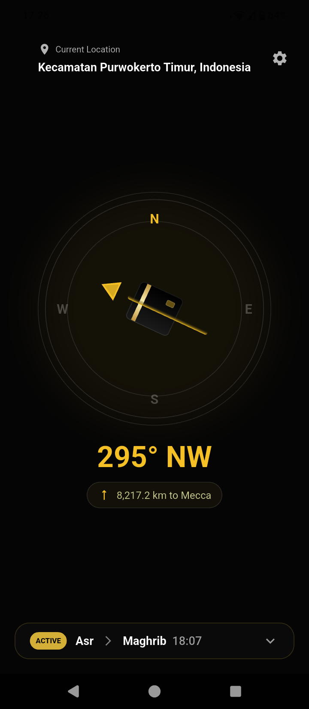
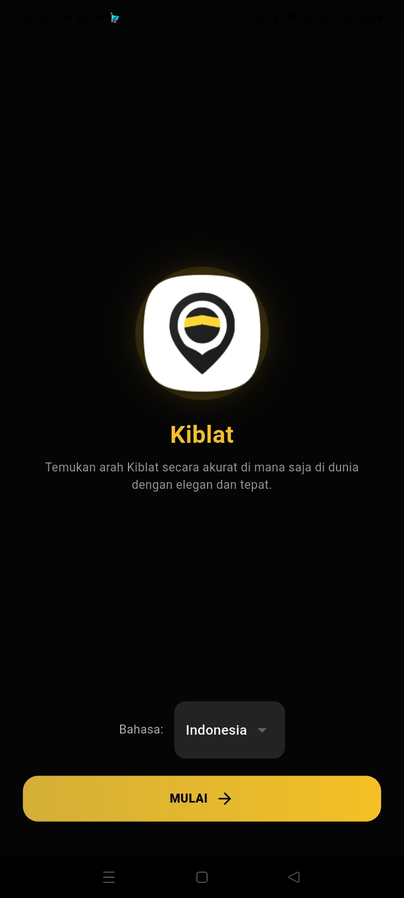
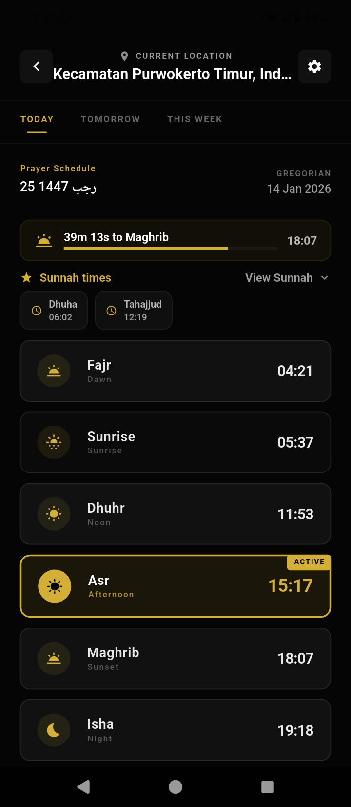
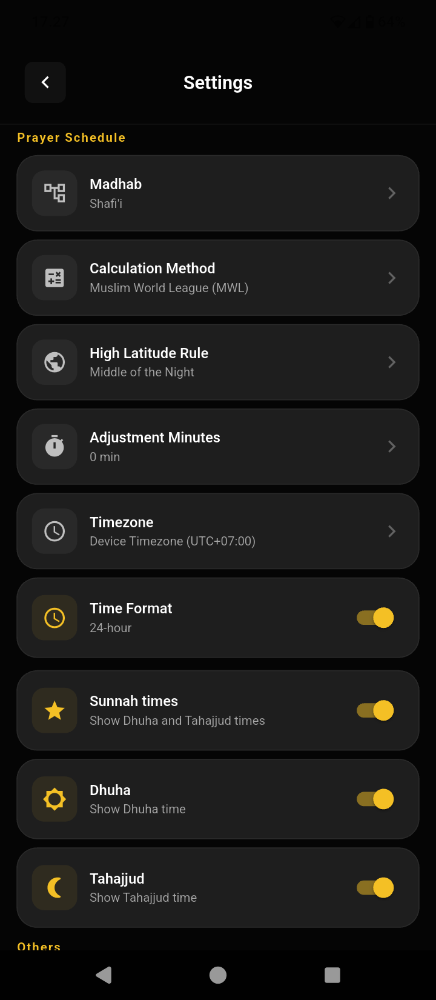
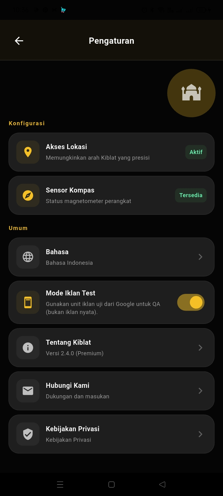

# Kiblat 📍 — Qibla + Prayer Buddy

[](https://play.google.com/store/apps/details?id=id.onyet.app.kiblat)

Hey! Kiblat is a tiny, chill Flutter app that points you to the Kaaba and now also shows prayer times. It uses your device's compass and location to give accurate bearings, and it's fully localized so it speaks your language. ✨

---

## What it does (TL;DR) ✅

- Shows precise Qibla direction with a smooth animated compass
- Displays local prayer times + reminders (notifications)
- Shows distance to Kaaba (in km)
- Simple settings: calculation method, timezone, notifications
- Localized UI and improved accessibility

---

## What's New — Release Highlights

- **Kiblat Pro** added: Lifetime purchase to remove ads and unlock exclusive features.
- **Dynamic Icons:** Exclusive gold PRO badge for premium users.
- **Advanced Reminders:** Custom offsets for prayer alerts.
- **Prayer Heatmap:** Visualize your prayer consistency over the last year.
- **Location History:** (Pro) Keep track of where you've performed your prayers.
- **Theme Engine:** Dynamic switching based on time and new Cyber/Dark themes.

---

## Screenshots 🖼️

Gallery (2x2 + single):

| | |
| ---: | :--- |
|  |  |
|  |  |
|  | |

---

## How it works (short nerdy bit) 🔧

- Qibla bearing: we compute the great-circle initial bearing from your location to the Kaaba (lat: 21.422487, lon: 39.826206). See `LocationService.qiblaBearing(lat, lon)`.
- Distance: spherical law of cosines -> distance in km. See `LocationService.distanceToKaabaKm(lat, lon)`.

Why great-circle? 'Cause Earth ain't flat and these formulas are accurate globally.

---

## Run locally (quickstart) 🚀

Requirements: Flutter SDK and a device/emulator with location & sensors.

1. Install deps:

```bash
flutter pub get
```

1. Run the app:

```bash
flutter run
```

Notes: Android needs location permission; iOS needs Info.plist keys (already in the repo). Google Maps reads `GOOGLE_API_KEY` from the ignored root `.env` file.

For GeoNames reverse geocoding, pass an active GeoNames username at build/run time:

```bash
flutter run --dart-define=GEONAMES_USERNAME=your_geonames_username
```

Place labels use the local cache first. When no nearby cached place is available and GeoNames is configured, the app sends the current coordinates to GeoNames. If that lookup fails or is not configured, it falls back to the platform geocoder, which may use the device platform's location services. The local database is a cache populated by successful lookups, not a bundled global city database.

---

## Build release (Android AAB) 🔒

1. Put your keystore (e.g., `keystore.jks`) in `android/` and create `android/key.properties` with local secrets (DO NOT commit):

```text
storePassword=YOUR_STORE_PASSWORD
keyPassword=YOUR_KEY_PASSWORD
keyAlias=YOUR_KEY_ALIAS
storeFile=keystore.jks
```

1. Build AAB:

```bash
flutter build appbundle --release
```

Add `--dart-define=GEONAMES_USERNAME=your_geonames_username` if GeoNames reverse geocoding should be enabled in the release build.

1. Upload `build/app/outputs/bundle/release/app-release.aab` to Play Console.

> Keep `android/key.properties` out of source control. Use CI secrets for automated builds.

---

## Where to look in the code 🧭

- `lib/screens/home_screen.dart` — compass UI & distance display
- `lib/screens/prayer_screen.dart` — prayer times UI
- `lib/screens/settings/prayer_settings_screen.dart` — prayer settings
- `lib/services/location_service.dart` — permission checks, heading stream, `qiblaBearing`, `distanceToKaabaKm`
- `assets/translations/` — locale JSONs

---

## Contribute / notes ✨

- Add screenshots to `assets/screenshots/` and tweak README. Contributions welcome.
- For even more precise geodesy, consider vincenty or geographiclib — current math is fine for practical use.

---

## QA & Test Ad Mode 🧪

- Debug builds auto-enable Test Ad Mode.
- In production you can toggle **Settings → Test Ad Mode** (saved via `SharedPreferences` key: `ad_test_mode`).
- Test mode uses Google’s test interstitial ad IDs and preloads ads for quick testing.

QA tips: watch logs for `[AdService]` and test exit flow to confirm interstitial behavior.

---

## Contact & Privacy 🔐

- **Privacy Policy:** <https://onyet.github.io/privacy-police.html>
- **Support:** <onyetcorp@gmail.com> (or WhatsApp: +62 822-2187-4400)

---

## Testing checklist ✔️

- Enable **Test Ad Mode** and confirm test interstitials load.
- Verify welcome/reset flows and interstitial behavior on exit.

---

License: MIT
